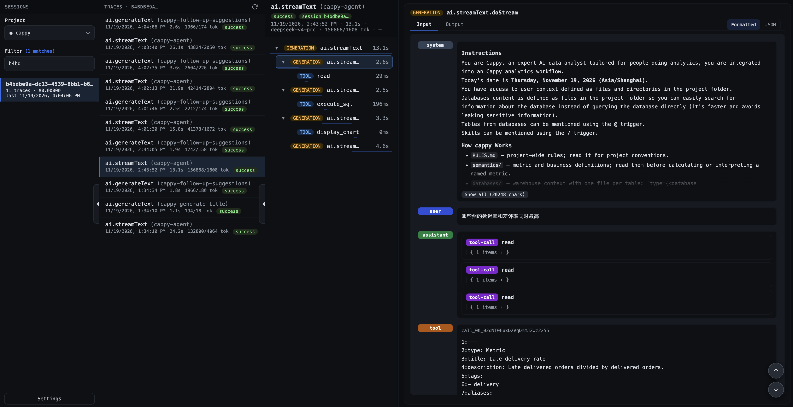

# minifuse

轻量的 LLM / agent trace 查看工具。单进程,仅依赖 SQLite,无外部服务。

如果你喜欢 Langfuse 的可观测性思路,但只需要一个查看 trace 的简单工具,minifuse 是一个更轻的选择。

## 特性

- **兼容 Langfuse 协议** — 支持 OTLP HTTP(protobuf / JSON)与 REST batch 接入,现有 Langfuse 集成仅需修改地址与密钥
- **SQLite 存储** — 基于 Bun 与 TypeScript 构建,单进程运行,无需 Postgres / Redis / ClickHouse 等外部服务
- **多项目隔离** — 每个项目对应一个独立的 SQLite 文件,删除项目即删除文件
- **trace 表滚动与自动过期** — trace 数据按容量滚动为多张表(类似滚动日志文件),超过保留数量自动删除最旧分区,避免数据无限增长
- **内嵌 Web UI** — 提供 trace 列表、调用树、session 聚合与 Formatted / JSON 双视图,随二进制一同分发



## 安装

```bash
git clone https://github.com/maruyue/minifuse.git
cd minifuse
./build.sh        # 构建单一二进制 ./minifuse(需要 Bun)
```

## 运行

```bash
MINIFUSE_PORT=3000 MINIFUSE_HOST=0.0.0.0 MINIFUSE_DATA=./data ./minifuse
```

## 接入

在 Web UI 中创建项目并生成 access key 后,按以下方式接入:

**OpenTelemetry**

```bash
export OTEL_EXPORTER_OTLP_ENDPOINT="http://localhost:3000/api/public/otel"
export OTEL_EXPORTER_OTLP_PROTOCOL="http/protobuf"     # 或 http/json
export OTEL_EXPORTER_OTLP_HEADERS="authorization=Basic <base64(pk:sk)>"
```

**Langfuse SDK(Python)**

```python
from langfuse import Langfuse

langfuse = Langfuse(
    public_key="pk-lf-...",
    secret_key="sk-lf-...",
    host="http://localhost:3000",
)
```

**Langfuse SDK(TypeScript)**

```ts
import { Langfuse } from "langfuse";

const langfuse = new Langfuse({
  publicKey: "pk-lf-...",
  secretKey: "sk-lf-...",
  baseUrl: "http://localhost:3000",
});
```

**REST API**

```bash
curl -X POST http://localhost:3000/api/public/traces \
  -u "pk-lf-...:sk-lf-..." \
  -H "Content-Type: application/json" \
  -d '{"batch": [{"id": "trace-1", "name": "my-trace"}]}'
```

## 环境变量

| 变量 | 默认值 | 说明 |
|---|---|---|
| `MINIFUSE_PORT` | 3000 | 监听端口 |
| `MINIFUSE_HOST` | 0.0.0.0 | 监听地址 |
| `MINIFUSE_DATA` | ./data | 数据目录 |

## License

[Apache License 2.0](LICENSE)
